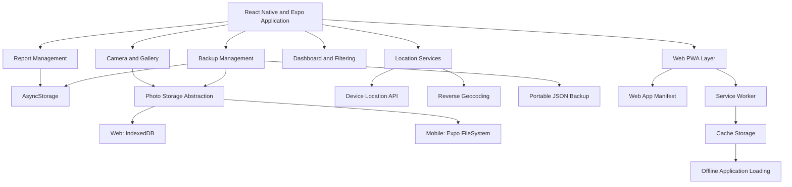
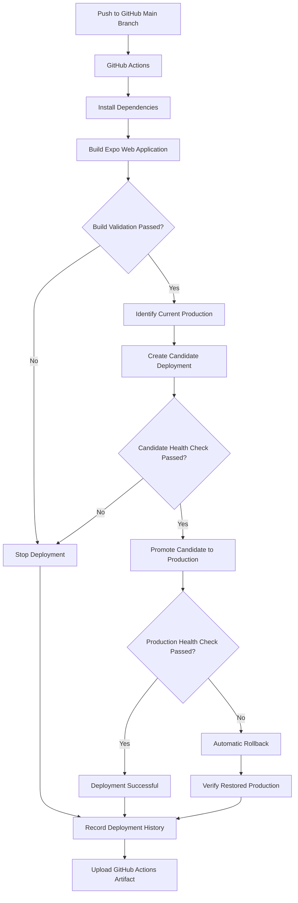

# CampusReport – SmartCampus


## 1. Project Overview
CampusReport – SmartCampus is a cross-platform campus issue reporting application developed to support a safer, cleaner and more efficient university environment.

The application enables students and staff to report campus-related issues, attach photographic evidence, capture geographical locations and manage reports through an interactive dashboard.

The project was developed using React Native and Expo, with a shared codebase supporting web and mobile platforms.

The web application also supports Progressive Web App (PWA) functionality, enabling installation on compatible devices, offline access to the application and local report management without an active internet connection.

The application uses a service worker and cached application resources to support offline operation, while persistent local storage preserves reports and photographic evidence across application sessions.

> Report an issue. Improve our campus.

## 2. Live Application
**Production website:**
https://campusreport-smartcampus.vercel.app

**GitHub repository:**
https://github.com/EduardPovazhnyi/campusreport-smartcampus

**Automated deployment pipeline:**
https://github.com/EduardPovazhnyi/campusreport-smartcampus/actions

## 3. Key Features
### Campus Issue Reporting
- Create, edit and delete campus issue reports.
- Assign reports to five predefined categories:
  - IT & Wi-Fi
  - Facilities
  - Outdoor & Grounds
  - Cleanliness
  - Safety
- Automatically record report creation timestamps.
- Manage report priorities: Low, Medium and High.
- Manage report statuses: Submitted, In Progress and Resolved.

### Photographic Evidence
- Capture photographs using the device camera.
- Select multiple photographs from the device gallery.
- Attach up to ten photographs per report.
- Preview and remove photographs before submission.
- View draft and stored photographs in a full-screen gallery before and after report submission.
- Navigate between photographs using controls and mobile swipe gestures.

### Geolocation
- Capture geographical coordinates using device location services.
- Convert coordinates into readable location names through reverse geocoding.
- Handle unavailable location services and permissions.

### Interactive Dashboard
- Display the total number of reports.
- Monitor submitted, in-progress and resolved reports.
- Filter reports by status.
- Search report descriptions.
- Sort reports by creation date or priority.
- Expand and collapse dashboard and filtering sections.

### Data Persistence and Backup
- Preserve reports between application sessions.
- Store photographs persistently using platform-specific storage.
- Export reports and photographs into portable JSON backup files.
- Import backups without overwriting existing reports.
- Detect and skip duplicate reports.
- Validate backup contents before restoration.
- Transfer report data between web and Android platforms.

### User Experience and Accessibility
- Responsive layouts for desktop and mobile screens.
- Consistent visual identity and colour-coded report indicators.
- Accessible labels for interactive controls.
- Keyboard-aware mobile interface.
- Safe-area handling for mobile devices.
- Visual feedback during backup operations.

### User Interface Improvements
- Dynamic multiline report description sizing, expanding and contracting as text is edited.
- Compact spacing between descriptions, photograph counters and report metadata.
- Adaptive report card spacing across Web and Android.

### Progressive Web App (PWA) and Offline Support
- Installable web application with custom application icons.
- Web App Manifest and service worker integration.
- Offline application loading after initial caching.
- Offline creation, editing and deletion of campus reports.
- Offline photographic evidence management.
- Persistent local storage of reports and photographs.
- Graceful handling of unavailable reverse geocoding services.
- Restoration of online functionality when internet connectivity returns.

## 4. Technology Stack
| Technology | Purpose |
|---|---|
| React Native | Cross-platform application development |
| Expo SDK 54 | Development framework and device APIs |
| JavaScript | Application and deployment automation logic |
| React Native Web | Browser-based application support |
| Web App Manifest | PWA installation and application configuration |
| Service Worker API | Offline application support and network request handling |
| Cache Storage API | Persistent caching of web application resources |
| AsyncStorage | Persistent report metadata |
| IndexedDB | Persistent web photograph storage |
| Expo FileSystem | Native photograph and file storage |
| Expo Location | GPS and reverse geocoding |
| OpenStreetMap Nominatim | Fallback reverse geocoding |
| Expo ImagePicker | Camera and gallery integration |
| Expo DocumentPicker | Backup file selection |
| Expo Sharing | Mobile backup export |
| React Native Paper | User interface components |
| Git and GitHub | Version control and source code management |
| GitHub Actions | Continuous integration and deployment |
| Vercel | Web application hosting |
| Node.js | Deployment agent execution environment |

## 5. Application Architecture
The application uses a shared React Native codebase with platform-specific photograph storage implementations.



This architecture separates platform-specific photograph storage from the shared application logic, supporting maintainability and cross-platform compatibility. The web-only PWA layer provides installation metadata and caches application resources independently of report and photograph storage.

## 6. Project Structure
```text
campusreport-smartcampus/
├── .github/
│   └── workflows/
│       └── deployment-agent.yml
├── assets/
├── components/
├── public/
│   ├── health.json
│   ├── manifest.json
│   ├── service-worker.js
│   ├── icon-192.png
│   └── icon-512.png
├── App.js
├── index.js
├── app.json
├── agent.js
├── photoStorage.js
├── photoStorage.web.js
├── photoStorage.native.js
├── package.json
├── package-lock.json
├── vercel.json
├── .gitignore
└── README.md
```

## 7. Installation and Local Development
### Prerequisites
- Node.js
- npm
- Git
- Expo Go compatible with Expo SDK 54 for mobile testing

### Clone the Repository
```bash
git clone https://github.com/EduardPovazhnyi/campusreport-smartcampus.git
cd campusreport-smartcampus
```

### Install Dependencies
```bash
npm ci
```

### Start the Development Server
```bash
npx expo start
```

### Run the Web Application
```bash
npx expo start --web
```

### Run on a Physical Mobile Device
```bash
npx expo start --tunnel
```

Scan the generated QR code using a compatible Expo Go application.

### Generate a Production Web Build
```bash
npx expo export --platform web
```

The production build is generated in the `dist` directory.

On Windows systems where PowerShell execution policies restrict npm scripts, `npm.cmd` and `npx.cmd` can be used instead.

### Install the Progressive Web App

1. Open the production website in a compatible browser, such as Chrome or Edge.
2. Use the browser’s installation option in the address bar or browser menu, when available.
3. Launch CampusReport from the installed application shortcut.

An initial online visit is required to load and cache application resources. Once caching is complete, the web application can be reopened offline. Installation is optional for browser-based offline operation. Native Android development testing uses Expo Go and is separate from PWA installation.

## 8. Data Storage and Backup
CampusReport uses a local-first data storage approach.

Report metadata is stored using AsyncStorage, while photographs are stored separately through platform-specific storage implementations.

| Platform | Report Metadata | Photographs |
|---|---|---|
| Web | AsyncStorage | IndexedDB |
| Android | AsyncStorage | Expo FileSystem |

The backup system combines report metadata and Base64-encoded photographs into a portable JSON file.

During backup restoration, the application validates the file structure and report contents, restores photographs and merges imported reports with existing records.

Duplicate reports are identified using their unique report identifiers and skipped.

The backup functionality was tested successfully in both directions:

- Web to Android.
- Android to Web.

The application does not require a central database or cloud storage service for its core functionality.

### Offline Storage and PWA Behaviour

The service worker uses Cache Storage for web application resources. Report metadata and photographic evidence remain in their existing persistent storage layers (AsyncStorage and IndexedDB on the web). Caching the application is therefore separate from saving user data.

After initial caching, users can manage locally stored reports and photographs without an active internet connection. Reverse geocoding requires network access when using the external fallback service; a report can retain available coordinates even when a readable location name cannot be retrieved. Online functionality becomes available again when connectivity returns.

Offline operation does not imply automatic cloud synchronisation. Cross-device transfer continues to use explicit JSON backup export and import.

## 9. Automated CI/CD Deployment Agent
The project includes a custom Node.js deployment automation agent integrated with GitHub Actions and Vercel.

The agent provides rule-based deployment decision-making, automated build validation, deployment health checks, production promotion, failure handling and rollback.

The workflow is triggered automatically when changes are pushed to the `main` branch and can also be initiated manually.

### Deployment Pipeline


### Deployment Configuration
The deployment pipeline uses the following GitHub repository secrets:

- `VERCEL_TOKEN`
- `VERCEL_ORG_ID`
- `VERCEL_PROJECT_ID`
- `VERCEL_AUTOMATION_BYPASS_SECRET`

The following repository variables provide deployment configuration:

- `PRODUCTION_URL`
- `HEALTH_PATH`

Sensitive credentials are stored securely in GitHub Actions Secrets and are not included in the source code.

Vercel Deployment Protection remains enabled for protected deployments. The automation bypass secret allows the deployment agent to perform authenticated health checks.

## 10. Health Checks and Automatic Rollback
The application provides a dedicated health endpoint:

https://campusreport-smartcampus.vercel.app/health.json

Expected response:

```json
{
  "status": "ok",
  "application": "CampusReport"
}
```

The deployment agent checks candidate deployments before production promotion and verifies production availability after promotion.

If a candidate fails its health checks, the deployment process stops before promotion.

If the production health check fails after promotion, the agent attempts to restore the previous production deployment and verifies its availability.

The health checks provide deployment-level validation. They do not replace comprehensive functional or end-to-end application testing.

### Deployment History
Each agent execution records deployment information in:

```text
deployment-history.json
```

The file is uploaded as a GitHub Actions artifact named `deployment-history`.

Artifacts are retained for 30 days, providing an auditable record of successful and failed deployment attempts.

### Rollback Validation
The automatic rollback mechanism was tested using a controlled simulation of a production health-check failure.

The test successfully demonstrated:

- Candidate deployment creation.
- Candidate health validation.
- Production promotion.
- Simulated production failure handling.
- Automatic restoration of the previous deployment.
- Successful post-rollback health verification.
- Deployment history recording.

The rollback was independently confirmed through the Vercel deployment dashboard.

Normal deployment logic was subsequently restored and a final successful production deployment was completed.

## 11. Testing and Validation
The application was manually tested on desktop web browsers and a physical Android device.

| Test Scenario | Result |
|---|---|
| Report creation, editing and deletion | Passed |
| Category selection | Passed |
| Status and priority management | Passed |
| Search, filtering and sorting | Passed |
| Dashboard statistics | Passed |
| Camera and gallery integration | Passed |
| Multiple photograph attachments | Passed |
| Full-screen photograph viewer | Passed |
| GPS and reverse geocoding | Passed |
| Responsive web layout | Passed |
| Persistent report storage | Passed |
| Persistent photograph storage | Passed |
| Backup export and import | Passed |
| Duplicate backup detection | Passed |
| Invalid backup rejection | Passed |
| Web-to-Android data transfer | Passed |
| Android-to-Web data transfer | Passed |
| Automated web deployment | Passed |
| Authenticated candidate health checks | Passed |
| Production health checks | Passed |
| Automatic rollback simulation | Passed |
| Post-rollback health verification | Passed |
| Data persistence following redeployment | Passed |
| Production service worker activation | Passed |
| Offline application loading after initial caching | Passed |
| Offline report creation with photographic evidence | Passed |
| Offline report and photograph persistence | Passed |
| Online recovery and report creation | Passed |
| Dynamic multiline description expansion and contraction on Web and Android | Passed |
| Updated report card spacing and photograph positioning | Passed |
| Production UI validation following redeployment | Passed |

The final cross-platform backup validation used ten demonstration reports, including photographic evidence, geographical coordinates and different report statuses.

The cross-platform backup validation was followed by PWA and interface refinement tests. Production PWA testing used Chrome DevTools offline mode and confirmed that the application remained accessible with locally stored reports and photographs. Offline and online recovery test reports were retained, bringing the production browser’s local demonstration dataset to twelve reports.

The report card layout was refined and tested locally on Web and a physical Android device using Expo Go. The changes were committed to the feature branch, merged into `main` through a pull request and deployed through the existing automated pipeline.

The latest confirmed production deployment completed successfully on 27 November 2026. The GitHub Actions job completed in 1 minute 22 seconds, with successful build validation, candidate and production health checks, and deployment history recording. These checks were complemented by manual production UI and offline validation.

## 12. Security and Privacy Considerations
- Deployment credentials are managed through GitHub Actions Secrets.
- Protected candidate deployments are accessed using an automation bypass secret.
- Backup contents are validated before restoration.
- Duplicate report identifiers are detected during import.
- Application data remains within local platform storage unless explicitly exported.
- Personal backup files are excluded from the public source code repository.
- PWA resources are cached locally; browser storage is not a substitute for encrypted or access-controlled storage.
- Reverse geocoding may transmit coordinates to an external location service when online.

Backup files may contain photographs and geographical coordinates. They should therefore be handled as potentially sensitive data.

## 13. Known Limitations and Future Development
The current application is a functional academic prototype.

Known limitations include:

- Reports are stored locally rather than in a shared central database.
- Cross-device data transfer requires manual backup export and import.
- User authentication and role-based access control are not implemented.
- Backup files are not encrypted.
- Location accuracy depends on device permissions and available location services.
- Native iOS functionality has not been tested.
- Offline web loading requires an initial successful online visit and cached application resources.
- External reverse geocoding may be unavailable offline.
- Clearing browser site data may remove local reports, photographs and cached resources.
- PWA installation and offline behaviour depend on browser support and storage availability.
- Deployment health checks do not provide full functional test coverage.

Potential future enhancements include:

- Centralised cloud database integration.
- Secure user authentication.
- Role-based report management.
- Real-time cross-device synchronisation.
- Notifications and report assignment.
- Administrative analytics.
- Automated end-to-end testing.
- Encrypted backup files.
- Campus map integration and improved location accuracy feedback.
- Broader PWA compatibility and cache update testing.

## 14. Academic Context
This project was developed as part of the BSc (Hons) Computer Science programme at the University of the West of Scotland.

****Module:**** COMP10013 – Dynamic Web Technologies

****Academic Year:**** 2026–2027

****Project:**** CampusReport – SmartCampus

The project demonstrates practical application of cross-platform development, responsive interface design, device API integration, persistent storage, data portability, Progressive Web App development, offline functionality, adaptive multiline interface design, software testing and automated deployment practices.

Demonstration reports and associated images are used for academic testing and illustration and should not be interpreted as verified university incidents.

This is an independent academic project and is not an official University of the West of Scotland reporting service.

## 15. Author
**Eduard Povazhnyi**
BSc (Hons) Computer Science

University of the West of Scotland

GitHub: https://github.com/EduardPovazhnyi

---
**CampusReport – SmartCampus**
**Report an issue. Improve our campus.**
